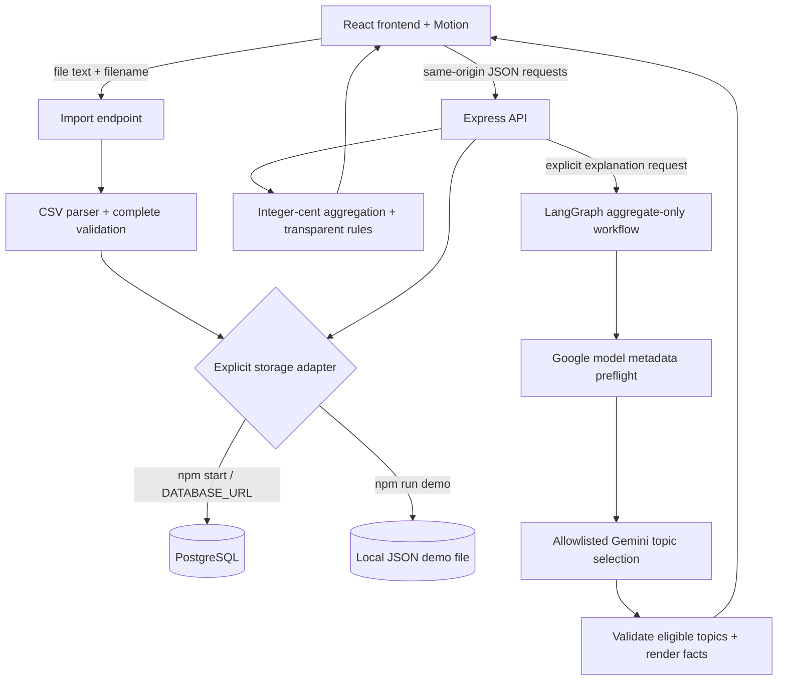

# SpendScope architecture

## Boundaries

The built React SPA and API share one Express origin on port8012. Browser code never accesses PostgreSQL directly or knows provider credentials. Express routes call domain functions and one selected storage adapter. The two adapters have the same async interface: `init`, `ingest`, `rows`, `dashboard`, `close`, plus an explicit mode identifier.

The domain module is independent of HTTP and storage. It returns validated rows using exact integer cents, computes filtered analytics, and serializes safe CSV. This separation allows both adapters and most tests to exercise the same rules.

The PostgreSQL adapter executes SQL against real tables; the demo adapter uses an atomically replaced local JSON snapshot and a single-process mutation queue. There is no hybrid write path and no fallback after a failed PostgreSQL connection.

## Read flow

React assembles one filter query and fetches dashboard and transaction page concurrently. An AbortController cancels superseded reads. Dashboard calculates summary/trend/category/pattern information; transaction endpoint applies a stable chosen sort and slices one page. Dimension options remain global. Export executes the same filters and exports the full matching set.

The implementation favors clarity over high-volume optimization: rows are materialized in application memory and analytics run in JavaScript. PostgreSQL filtering is parameterized; dashboard currently reads all rows to maintain one consistent set of dimensions and analytics. Large-data versions should use SQL aggregates, indexed range filters and database pagination.

## Write flow

Browser verifies size and submits file text. Server parses and validates the whole CSV. Only after that succeeds does storage commit the batch. PostgreSQL wraps import metadata and transactions in BEGIN/COMMIT; file mode serializes writes and renames a complete new state before publishing it in memory. Bad validation never writes any row.

## AI flow

Summary is sanitized to aggregate numeric data before entering LangGraph. Preflight verifies selected-model access. Gemini selects eligible observation codes. Strict validation rejects unknown or invented fields; server templates calculate all displayed dollar figures from context. No raw merchant/category text, tool execution, autonomous loop or conversation state is needed.

No-key and provider failures remain optional errors and never affect imports or charts. Local cache/limits protect against accidental repeated clicks, but durable shared budgeting is a deployment requirement beyond this release.

## Startup and deployment

`server/index.js` selects mode, initializes storage, optionally loads the fixed-ID seed and starts the listener. Default host is127.0.0.1; Docker binds all container interfaces but publishes only localhost. SIGINT/SIGTERM closes HTTP and database resources. `Dockerfile` builds the frontend separately, installs production server packages in runtime, and runs as the non-root node user.

Compose persists PostgreSQL in a named volume and waits for its healthcheck before starting the app. Native Postgres CI creates a test database; each test creates/removes only its own schema. Local native PostgreSQL18.4 adapter verification passed, including injected mid-batch rollback. A PGlite wire check is additional evidence and does not establish multi-session concurrency. The current tests do not claim a multi-client load benchmark.

## Operational gaps

Single-user access, no auth/TLS/tenant isolation, startup-only idempotent migration, no import edit/undo, no backup task, and no durable AI quotas are explicit. A hosted service needs these controls plus production secret handling and observability before public exposure.
