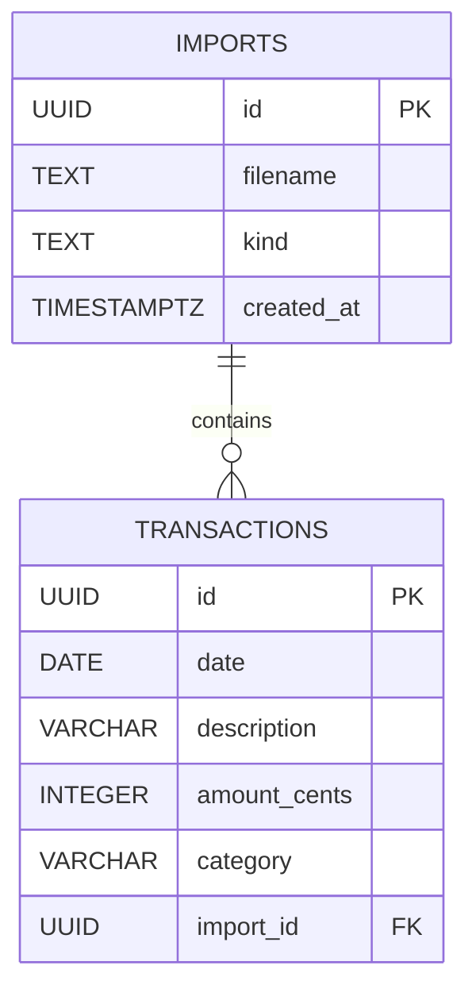

# SpendScope database schema

The source migration is `migrations/001_initial.sql`. This document describes implemented fields, not proposed tables.



## imports

| Field | SQL type / constraint | Purpose |
| --- | --- | --- |
| id | UUID PRIMARY KEY | Unique import batch; random for user imports, fixed for seed |
| filename | TEXT NOT NULL | Basename capped to100 chars by storage code; metadata only |
| kind | TEXT NOT NULL, CHECK demo/import | Source disclosure; joined into transaction responses |
| created_at | TIMESTAMPTZ NOT NULL DEFAULT now() | Database import creation timestamp |

The synthetic seed uses UUID `00000000-0000-4000-8000-000000000001`. `INSERT ... ON CONFLICT (id) DO NOTHING RETURNING id` provides idempotency. No content hash/unique filename is implemented, so normal repeated uploads append.

## transactions

| Field | SQL type / constraint | Purpose |
| --- | --- | --- |
| id | UUID PRIMARY KEY | Stable identity for ledger and flags |
| date | DATE NOT NULL | Original calendar date, returned as ISO text |
| description | VARCHAR(200) NOT NULL | Merchant or descriptive text; server validates nonempty/control-free |
| amount_cents | INTEGER NOT NULL, CHECK 0–100000000 | Exact nonnegative expense amount |
| category | VARCHAR(60) NOT NULL | Exact category label; server validates nonempty/control-free |
| import_id | UUID NOT NULL REFERENCES imports(id) | Parent import; source kind is derived through join |

The schema has no user_id because this is single-user. It has no currency because all values are explicitly USD. Refunds, multiple currencies and tenant data require schema changes before support. The foreign key has default restrict/no-action behavior; there is no implemented delete-import endpoint.

## Indexes and queries

- Primary-key indexes on both UUIDs.
- `transactions_date_idx` on date, for chronological access and future range filters.
- `transactions_category_idx` on category, for exact-category filtering.
- Current month filter uses `to_char(date,'YYYY-MM')`; this does not fully exploit the ordinary date index. A future query should use month start/end date bounds.
- Current search uses literal `strpos(lower(description || ' ' || category),lower($n))`; no full-text/trigram index is implemented.
- Recurrence/outlier tables do not exist: they are derived from current filtered rows at request time.

## Transaction invariant

Validate all CSV rows before beginning a write. Then insert import metadata and every transaction in one PostgreSQL transaction. COMMIT only when all inserts succeed; ROLLBACK on any SQL error. A seed conflict returns zero inserted rows without touching existing user batches. SQL parameters isolate user text from query structure.

## Demo JSON representation

File mode is deliberately separate from the SQL schema:

```json
{
  "version": 1,
  "imports": [{ "id": "uuid", "filename": "expenses.csv", "kind": "import" }],
  "rows": [{ "id": "uuid", "date": "2026-06-01", "description": "Coffee", "amount_cents": 475, "category": "Dining", "import_id": "uuid", "source": "import" }]
}
```

It denormalizes source on rows for local reads and does not include a database-created timestamp. Atomic rename and one-process write serialization keep snapshots consistent; they do not provide multi-process database isolation. The normal demo data path is ignored by Git and Docker build context.

## Evolution requirements

A future migration ledger should version schema changes. Authentication needs user/tenant foreign keys and tenant-scoped query constraints. Currency/refund support needs explicit metadata and semantics. Duplicate content warnings need import content hashes. Import undo needs an authorized deletion path, while native PostgreSQL concurrency and backup/restore should be tested before hosted claims.
